# Awesome AI Observability & ML Model Evaluation 🔍 🤖

  

  
  
  
  
  
  

---

## 🧭 Overview & Mission

A curated index of top **Enterprise SaaS Platforms** and **Active Open-Source Projects** for **AI Observability, LLM Evaluation, and Machine Learning Model Monitoring**. 

Modern production AI applications—ranging from traditional tabular predictors to complex agentic LLM pipelines and RAG architectures—require continuous validation against **data drift**, **concept drift**, **performance decay**, **groundedness failures**, **hallucinations**, and **latency anomalies**. This repository benchmarks both managed vendor platforms and community-driven, self-hosted open-source tooling across the entire MLOps lifecycle.

---

## 📑 Table of Contents
- [📊 Sector Overview & Market Dynamics](#-sector-overview--market-dynamics)
- [🏢 SaaS & Hosted Platforms](#-saas--hosted-platforms)
- [🔓 Open-Source GitHub Projects](#-open-source-github-projects)
- [⭐ Star History](#-star-history)
- [💖 Support & Community](#-support--community)
- [🤝 How to Contribute](#-how-to-contribute)
- [⚖️ Disclaimer](#️-disclaimer)

---

## 📊 Sector Overview & Market Dynamics

The global **AI Observability and LLM Evaluation market** is estimated at **$1.8B to $2.4B in 2024–2025** and is projected to expand at an aggressive **CAGR of ~23%**, surpassing **$8.5B by 2032**, fueled by enterprise adoption of production Generative AI, autonomous agents, and mission-critical predictive ML. The sector has transitioned from being **moderately fragmented**—initially populated by specialized point-solution startups—toward a **rapidly consolidating, hybrid ecosystem** where major cloud data platforms (e.g., Snowflake, Databricks) and legacy APM giants (e.g., Dynatrace, Cisco/Splunk, Datadog) are acquiring or embedding native LLM evaluation and OpenTelemetry tracing suites, while nimble open-source standards retain deep grassroots developer dominance.

---

## 🏢 SaaS & Hosted Platforms

> [!NOTE]
> The table below compares top commercial AI and ML observability platforms, ranked in descending order by **Company Scale** (Valuation, Market Cap, or Acquisition Valuation). Specific starting tier prices and explicit free tier / trial boundaries are detailed for production architecture evaluation.

| Product / Platform | Company Scale (Valuation / Revenue) 📈 | Starting Paid Tier 💳 | Free Plan Limits / Free Trial Period 🎁 | Primary Capabilities & Focus Areas 🎯 |
| :--- | :--- | :--- | :--- | :--- |
| **[Snowflake AI Observability (formerly TruEra)](https://snowflake.com)** | **$55B – $75B** Market Cap (~$3.6B+ ARR) | Usage-based compute starting at ~$2.00–$2.20 per AI credit / Cortex capacity | **30-day free trial** with **$400 free platform credits** across Snowflake Cortex & TruLens governance suites | Enterprise data cloud platform embedding TruEra & TruLens for RAG groundedness, hallucination mitigation, context relevance, and model drift. |
| **[LangSmith (LangChain)](https://smith.langchain.com)** | **$3.0B** Valuation ($460M raised) | **$39 / seat / month** (Plus Plan) | **Free forever plan**: Up to 1 seat, **5,000 traces/month**, and 14 days data retention | End-to-end LLM application lifecycle platform from LangChain for trace debugging, regression test suites, prompt playground, and online evaluation. |
| **[Weights & Biases (Models & Weave)](https://wandb.ai)** | **$1.7B** Valuation (~$50M+ ARR) | **$50 / user / month** (Team Plan) | **Free forever plan**: Up to 5 model seats, 100 GB storage, and **1 GB/month** Weave LLM trace ingestion | MLOps and LLMOps foundation uniting ML experiment tracking, model registry governance, artifact versioning, and Weave agent tracing. |
| **[Monte Carlo Data](https://montecarlodata.com)** | **$1.6B** Valuation ($230M+ raised) | Enterprise contract starting at **~$25,000 / year** | **14 to 30-day Proof-of-Concept (POC)** free trial evaluating designated warehouse/lakehouse tables | End-to-end data and AI pipeline observability platform monitoring feature stores, vector databases, freshness, volume, and schema integrity. |
| **[Arize AI (Arize AX)](https://arize.com)** | **$915M** (Acquired by Dynatrace) | **$50 / month** flat rate (AX Pro Plan) | **Free forever plan** (AX Free): **25,000 spans/month**, 1 GB storage, 15 days retention, unlimited users & eval workflows | Enterprise ML/LLM observability with high-dimensional embedding drift visualization, OpenTelemetry tracing, and automated judge evaluators. |
| **[Braintrust](https://braintrust.dev)** | **$800M** Valuation ($120M+ raised) | **$249 / month** platform fee (Pro Plan) | **Free forever plan** (Starter Plan): **1 GB processed data/month**, **10,000 scores/month**, $10 model credits, 14 days retention | Enterprise AI evaluation engine transforming production logs into golden benchmark datasets with automated CI/CD scoring workflows. |
| **[Fiddler AI](https://fiddler.ai)** | **$400M** Valuation ($100M+ raised) | **$0.002 / trace** (Developer Usage Tier) | **Free forever tier**: Unlimited real-time Centor guardrails for prompt injection, jailbreaks, PII, and toxicity | Real-time predictive ML monitoring, SHAP explainability, and ultra-low latency guardrails mitigating hallucinations and adversarial safety breaches. |
| **[Galileo](https://rungalileo.io)** | **~$250M – $300M** Est. ($68M raised) | **$100 / month** billed annually (Pro Plan) | **Free forever plan**: Up to **5,000 traces/month**, unlimited users, and unlimited custom evaluations | Enterprise LLM evaluation and real-time guardrail platform featuring Luna evaluation models, hallucination scoring, and RAG error clustering. |
| **[Arthur AI (Scope & Shield)](https://arthur.ai)** | **~$150M – $200M** Est. ($65.7M raised) | **$60 / month** (Premium Plan) | **Free forever plan**: **4 use cases**, 2 projects, **300,000 spans**, 12k inferences, and 7 days retention | Model monitoring and LLM firewall platform delivering bias/fairness auditing, data drift detection, and production prompt defense. |
| **[Evidently Cloud](https://evidentlyai.com)** | **~$60M – $80M** Est. ($15M Series A) | **$80 / month** (Pro Plan) | **Free forever plan** (Developer Plan): 2 seats, **10,000 rows/month**, 1 GB snapshot storage, and 3 projects | Managed cloud platform for continuous ML/LLM evaluation test suites, automated regression alerts, drift dashboards, and synthetic data generation. |
| **[WhyLabs](https://whylabs.ai)** | **$37M** (Acquired by Apple) | **$125 / month** (Expert Plan) | **Free forever plan** (Starter Plan): Up to **10 million predictions/month**, 200 features/project, and daily monitoring | Privacy-preserving AI observability using statistical data sketches (`whylogs`) to detect data drift and anomalies without raw payload inspection. |

---

## 🔓 Open-Source GitHub Projects

> [!TIP]
> The table below showcases premier open-source frameworks for ML monitoring, LLM-as-a-judge evaluations, data drift calculations, and OpenTelemetry instrumentation. All repositories are sorted in descending order by **GitHub Star Count**. Star badges link directly to each project's stargazers community.

| Repository / Project | GitHub Stars 🌟 | Primary Category / Focus 🏷️ | Core Description & Capabilities 💡 |
| :--- | :---: | :--- | :--- |
| **[Langfuse](https://github.com/langfuse/langfuse)** |  | LLM Tracing & Eval Platform | Leading self-hostable open-source LLM engineering platform for full-stack trace observability, prompt versioning, evaluations, and latency/cost analytics. |
| **[SigNoz](https://github.com/SigNoz/signoz)** |  | Full-Stack OpenTelemetry APM | High-performance open-source APM native to OpenTelemetry, unifying distributed traces, application logs, and GPU/model performance metrics. |
| **[MLflow](https://github.com/mlflow/mlflow)** |  | MLOps & LLM Lifecycle | Ubiquitous open-source MLOps platform featuring comprehensive experiment tracking, model registry, `mlflow.evaluate()` automated ML/LLM scoring, and OTel tracing. |
| **[Promptfoo](https://github.com/promptfoo/promptfoo)** |  | Prompt CI/CD & Red-Teaming | Blazing-fast CLI and test library for declarative LLM benchmarking, security scanning, prompt injection defense, and continuous integration regression gating. |
| **[SHAP](https://github.com/shap/shap)** |  | ML Model Explainability | Standard game-theoretic approach (Shapley Additive exPlanations) for explaining complex model predictions and uncovering localized bias or feature anomalies. |
| **[Opik](https://github.com/comet-ml/opik)** |  | LLM Tracing & Evaluation | Open-source platform from Comet designed for high-throughput LLM span tracing, automated evaluators, dataset annotation, and regression tracking. |
| **[DeepEval](https://github.com/confident-ai/deepeval)** |  | Unit-Testing LLM Framework | Pytest-like evaluation framework delivering 40+ research-backed metrics for RAG faithfulness, hallucination rates, contextual recall, and automated judge scoring. |
| **[Ragas](https://github.com/explodinggradients/ragas)** |  | RAG Pipeline Evaluation | Widely adopted framework specialized in measuring retrieval precision, context recall, answer groundedness, and synthetic test dataset generation for RAG pipelines. |
| **[Arize Phoenix](https://github.com/Arize-ai/phoenix)** |  | AI Observability & Tracing | OpenTelemetry-native AI observability engine featuring interactive trace waterfalls, UMAP embedding drift clusters, RAG diagnostics, and notebook evaluation. |
| **[LIME](https://github.com/marcotcr/lime)** |  | Local Model Interpretability | Local Interpretable Model-agnostic Explanations for explaining what individual ML classifiers and regressors are doing to support drift investigations. |
| **[Great Expectations](https://github.com/great-expectations/great_expectations)** |  | Data Quality & Pipeline Testing | Industry standard for data pipeline validation, preventing silent schema drifts, null spikes, and contaminated training features from breaking production models. |
| **[Cleanlab](https://github.com/cleanlab/cleanlab)** |  | Data-Centric AI & Label Errors | Open-source framework for detecting label errors, dataset corruptions, out-of-distribution inputs, and data curation defects in ML datasets. |
| **[Evidently](https://github.com/evidentlyai/evidently)** |  | ML & LLM Drift Monitoring | Flagship Python library and interactive UI for evaluating, testing, and monitoring ML models with 100+ built-in checks for tabular drift, accuracy decay, and LLM text quality. |
| **[OpenLLMetry](https://github.com/traceloop/openllmetry)** |  | OpenTelemetry GenAI Instrumentation | OpenTelemetry instrumentation extensions capturing standardized traces, prompt variables, and latency metrics across LLM SDKs and agent libraries. |
| **[River](https://github.com/online-ml/river)** |  | Streaming Machine Learning & Drift | Python library for streaming online machine learning with built-in real-time concept drift detectors including ADWIN, DDM, and Page-Hinkley. |
| **[Giskard](https://github.com/Giskard-AI/giskard)** |  | AI QA & Vulnerability Scanning | Automated testing framework for both traditional predictive models and LLMs, scanning for biases, data leaks, hallucinations, and security vulnerabilities. |
| **[Deepchecks](https://github.com/deepchecks/deepchecks)** |  | Continuous ML Validation Suites | Full-lifecycle validation library for tabular, NLP, and computer-vision models checking data integrity, train-test leakage, and production distributions. |
| **[TruLens](https://github.com/truera/trulens)** |  | RAG Feedback Functions | Systematic evaluation library for LLMs and RAG stacks utilizing programmable feedback functions (Context Relevance, Groundedness, Answer Relevance). |
| **[OpenLIT](https://github.com/openlit/openlit)** |  | OTel AI & GPU Observability | OpenTelemetry-native AI engineering platform providing zero-code auto-instrumentation for 50+ LLMs, vector databases, GPU usage, and hallucination scores. |
| **[AI Fairness 360 (AIF360)](https://github.com/Trusted-AI/AIF360)** |  | Algorithmic Bias & Fairness | IBM's extensible open-source toolkit helping data scientists examine, report, and mitigate algorithmic bias throughout machine learning model workflows. |
| **[whylogs](https://github.com/whylabs/whylogs)** |  | Statistical Data Logging | Compact logging standard generating mathematical summaries and statistical sketches of data streams to detect distribution drift with zero data egress. |
| **[Alibi Detect](https://github.com/SeldonIO/alibi-detect)** |  | Outlier & Drift Detection | Seldon's algorithms library specializing in outlier detection, adversarial perturbation detection, and statistical concept drift across tabular, text, and images. |
| **[Soda Core](https://github.com/sodadata/soda-core)** |  | Data Reliability Testing | Declarative SQL-based data validation and reliability CLI verifying upstream feature tables and warehouse sources feeding downstream inference pipelines. |
| **[Elementary](https://github.com/elementary-data/elementary)** |  | dbt-Native Data Observability | Open-source data observability and automated anomaly detection built natively on dbt, monitoring data pipeline regressions and warehouse tables. |
| **[Fairlearn](https://github.com/fairlearn/fairlearn)** |  | ML Fairness & Disparity Metrics | Python library empowering developers to assess and improve the fairness of artificial intelligence systems by measuring disparate performance impact. |
| **[NannyML](https://github.com/NannyML/nannyml)** |  | Label-Free ML Performance Estimation | Specialized post-deployment model monitoring library that estimates production model degradation (using CBPE and DLE) when ground-truth labels are delayed. |
| **[OpenInference](https://github.com/Arize-ai/openinference)** |  | OTel GenAI Semantic Standards | OpenTelemetry semantic conventions and instrumentation packages standardizing how LLM prompts, completions, embeddings, and tool calls are captured. |

---

## ⭐ Star History

---

## 💖 Support & Community

Thank you for exploring and bookmarking this repository! 🙏

If you find this curated collection useful for your MLOps architecture, research, or production system evaluations, please consider supporting the project:
- ⭐ **Star this repository** to help others discover it across GitHub.
- 🍴 **Fork and contribute** your favorite observability tools, benchmarks, and guides.
- 📢 **Share it** with colleagues, MLOps teams, and developer communities.
- ☕ **Support the maintainer** with a virtual coffee via the [GitHub Sponsor Dashboard](https://github.com/sponsors/ishandutta2007).

Your support keeps this directory updated, impartial, and aligned with cutting-edge production AI breakthroughs!

---

## 🤝 How to Contribute

Contributions are wholeheartedly welcomed! Please follow these simple steps:
1. Fork the repository.
2. Add your suggested tool or framework under the corresponding category (keep descriptions factual, concise, and linked directly to official repositories/websites).
3. Ensure table formatting remains consistent and aligned.
4. Open a clear Pull Request with a short summary of the addition.

---

## ⚖️ Disclaimer

All product names, logos, and brands are property of their respective owners. Mention of SaaS platforms or open-source projects does not constitute official endorsement. Pricing tiers, limits, and market valuations are compiled from public vendor documentation, marketplace listings, and financial analyses as of late 2026 and are subject to change.
